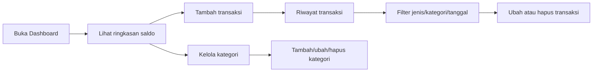
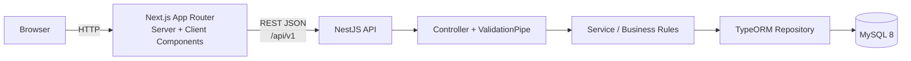
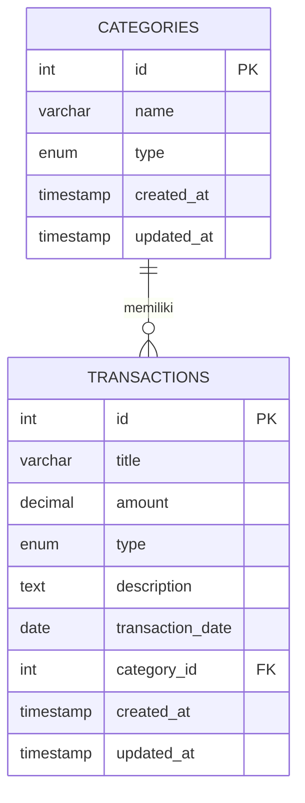

# PRD — Finance Management

Aplikasi pencatatan pemasukan dan pengeluaran berbasis web, dibangun dengan **Next.js** (frontend) dan **NestJS + TypeORM + MySQL** (backend), mengacu pada tema **Finance Management** pada *Modul Upgrading-Implementasi*.

| Atribut | Nilai |
|---|---|
| Versi dokumen | 1.0 |
| Status | Draft untuk implementasi |
| Tanggal | 21 November 2026 |
| Stack | Next.js (App Router), TypeScript, NestJS 12, TypeORM, MySQL 8 |
| Repositori backend | `finance-management-api` (scaffold NestJS yang sudah ada) |
| Repositori frontend | `finance-management-web` (Next.js, terpisah) |
| Sumber kebutuhan | `MODUL UPGRADING-IMPLEMENTASI .pdf`, bagian **Finance Management** |

---

## 1. Ringkasan

Finance Management adalah aplikasi sederhana untuk mencatat, mengelompokkan, dan memantau transaksi keuangan. Pengguna dapat membuat transaksi **pemasukan** (*income*) dan **pengeluaran** (*expense*), mengelompokkannya ke dalam **kategori**, memfilter riwayat transaksi, serta melihat **ringkasan total pemasukan, total pengeluaran, dan saldo**.

Implementasi dilakukan dengan memanfaatkan kembali pola CRUD dan pengambilan data dari project TaskFlow, lalu menyesuaikan entity, relasi, validasi, proses bisnis, dan tampilan sesuai kebutuhan Finance Management. Repositori backend saat ini masih berupa scaffold NestJS dengan folder `src/database/*` kosong; seluruh modul finance belum tersedia dan akan dibangun berdasarkan PRD ini.

### 1.1 Tujuan

1. Menyediakan satu tempat untuk mencatat seluruh transaksi keuangan.
2. Memastikan setiap transaksi memiliki jenis dan kategori yang konsisten.
3. Menyajikan ringkasan keuangan yang akurat dan selalu mengikuti data transaksi.
4. Menyediakan riwayat transaksi yang mudah difilter dan ditelusuri.
5. Menjadi implementasi Fullstack Web Development yang menerapkan Next.js, NestJS, TypeORM, dan MySQL.

### 1.2 Non-goal

- Autentikasi, otorisasi, dan multi-pengguna.
- Integrasi rekening bank, pembayaran, atau impor mutasi.
- Anggaran (*budgeting*), transaksi berulang, utang/piutang, dan laporan pajak.
- Multi-currency. Mata uang tunggal: **IDR**.
- Aplikasi mobile native.

---

## 2. Persona dan Alur Pengguna

### 2.1 Persona

**Pengguna individu** — mahasiswa atau pekerja yang ingin mencatat pemasukan dan pengeluaran harian, melihat ke mana uang keluar, dan mengetahui saldo saat ini.

### 2.2 Alur utama



### 2.3 Alur rinci

1. Pengguna membuka dashboard dan melihat total pemasukan, total pengeluaran, saldo, serta transaksi terbaru.
2. Pengguna menekan **Tambah Transaksi**, memilih jenis (income/expense), lalu memilih kategori yang sesuai.
3. Transaksi disimpan; daftar transaksi dan ringkasan langsung mencerminkan data terbaru.
4. Pengguna membuka halaman transaksi, memfilter berdasarkan jenis, kategori, atau rentang tanggal.
5. Pengguna mengubah atau menghapus transaksi melalui aksi pada baris tabel.
6. Pengguna mengelola kategori pada halaman kategori; kategori yang masih dipakai transaksi tidak dapat dihapus.

---

## 3. Ruang Lingkup

### 3.1 In scope (P0)

| Area | Cakupan |
|---|---|
| Transaksi | Create, read (list + detail), update, delete untuk income dan expense |
| Kategori | Create, read, update, delete untuk kategori income dan expense |
| Integritas | Jenis transaksi harus sama dengan jenis kategori |
| Ringkasan | Total pemasukan, total pengeluaran, saldo |
| Filter | Jenis transaksi, kategori, rentang tanggal |
| Dashboard | Kartu ringkasan dan transaksi terbaru |
| UI | Halaman transaksi, form transaksi, halaman kategori, state loading/empty/error |
| API | REST JSON berversi, validasi server-side, error envelope konsisten |

### 3.2 P1 (disarankan, tidak memblokir MVP)

- Pencarian transaksi berdasarkan judul/deskripsi.
- Filter periode pada dashboard (semua waktu / bulan ini).
- Pagination dan sorting daftar transaksi.
- Jumlah transaksi per kategori pada halaman kategori.

### 3.3 Out of scope

- Login, register, session, role, dan kepemilikan data per pengguna.
- Upload lampiran/bukti transaksi.
- Recurring transaction dan notifikasi.
- Grafik tren bulanan dan ekspor CSV/PDF.
- Multi-currency dan kurs.
- Audit log dan soft delete.

> **Catatan keamanan:** karena autentikasi di luar lingkup, API tidak boleh diekspos ke internet publik tanpa lapisan autentikasi. Untuk demo, jalankan di localhost atau jaringan privat.

---

## 4. Definisi

| Istilah | Definisi |
|---|---|
| Income | Transaksi pemasukan; menambah saldo. |
| Expense | Transaksi pengeluaran; mengurangi saldo. |
| Kategori | Pengelompokan transaksi, memiliki nama dan jenis (`income` / `expense`). |
| Saldo | `totalIncome - totalExpense`. Dapat bernilai negatif. |
| Ringkasan | Agregat total pemasukan, total pengeluaran, dan saldo pada rentang filter. |
| Transaksi | Satu catatan keuangan dengan judul, nominal, jenis, kategori, tanggal, dan deskripsi opsional. |

---

## 5. Arsitektur Sistem



### 5.1 Prinsip

- **Frontend dan backend terpisah.** Next.js mengonsumsi REST API NestJS; tidak ada akses langsung ke database dari browser.
- **Backend adalah sumber kebenaran.** Semua validasi dan aturan integritas wajib diterapkan di server, bukan hanya di form.
- **Database dinormalisasi.** Kategori dan transaksi disimpan pada tabel terpisah dengan relasi one-to-many.
- **Fresh data.** Halaman keuangan tidak di-cache secara statis; data selalu diambil ulang setelah mutasi.
- **Kontrak API stabil.** Perubahan bentuk response harus disertai pembaruan tipe frontend.

### 5.2 Struktur repositori backend

```text
src/
  main.ts
  app.module.ts
  config/
    database.config.ts
  database/
    data-source.ts
    enums/transaction-type.enum.ts
    entities/category.entity.ts
    entities/transaction.entity.ts
    migrations/
    repositories/
  common/
    filters/http-exception.filter.ts
    dto/pagination.dto.ts
  modules/
    categories/
      categories.module.ts
      categories.controller.ts
      categories.service.ts
      dto/
    transactions/
      transactions.module.ts
      transactions.controller.ts
      transactions.service.ts
      dto/
```

`CategoriesModule` dan `TransactionsModule` diimpor oleh `AppModule`. Endpoint ringkasan berada di `TransactionsController` karena merupakan agregat transaksi.

### 5.3 Struktur repositori frontend

```text
app/
  layout.tsx
  page.tsx                         # dashboard
  transactions/
    page.tsx                       # daftar + filter
    new/page.tsx                   # form tambah
    [id]/edit/page.tsx             # form ubah
  categories/
    page.tsx                       # daftar + modal CRUD
components/
  layout/
  transactions/
  categories/
  ui/                              # table, modal, badge, pagination, toast
lib/
  api.ts                           # API client + error handling
  format.ts                        # format IDR dan tanggal
types/
  finance.ts                       # tipe kontrak API
```

### 5.4 Environment

**Backend (`finance-management-api/.env`)**

```dotenv
PORT=3000
DB_HOST=127.0.0.1
DB_PORT=3306
DB_USERNAME=root
DB_PASSWORD=
DB_DATABASE=finance_management
CORS_ORIGIN=http://localhost:3001
OBSERVE_APP_KEY=
OBSERVE_APP_SECRET=
```

**Frontend (`finance-management-web/.env.local`)**

```dotenv
API_BASE_URL=http://localhost:3000/api/v1
NEXT_PUBLIC_API_BASE_URL=http://localhost:3000/api/v1
```

- `API_BASE_URL` dipakai Server Components.
- `NEXT_PUBLIC_API_BASE_URL` dipakai Client Components untuk mutasi.
- `synchronize` TypeORM **wajib `false`**; skema dikelola melalui migration.
- CORS hanya mengizinkan origin frontend yang dikonfigurasi.

---

## 6. Model Data

### 6.1 Tabel `categories`

| Field | Tipe | Constraint | Keterangan |
|---|---|---|---|
| `id` | INT | PK, AUTO_INCREMENT | Primary key |
| `name` | VARCHAR(100) | NOT NULL | Nama kategori |
| `type` | ENUM('income','expense') | NOT NULL | Jenis kategori |
| `created_at` | TIMESTAMP | NOT NULL, DEFAULT CURRENT_TIMESTAMP | Waktu dibuat |
| `updated_at` | TIMESTAMP | NOT NULL, ON UPDATE CURRENT_TIMESTAMP | Waktu diperbarui |

**Constraint tambahan**

- `UNIQUE (name, type)` — mencegah kategori dengan nama dan jenis yang sama.
- `name` disimpan setelah `trim`; spasi berlebih dirapikan.

### 6.2 Tabel `transactions`

| Field | Tipe | Constraint | Keterangan |
|---|---|---|---|
| `id` | INT | PK, AUTO_INCREMENT | Primary key |
| `title` | VARCHAR(150) | NOT NULL | Nama/keterangan transaksi |
| `amount` | DECIMAL(12,2) | NOT NULL, CHECK (`amount` > 0) | Nominal transaksi |
| `type` | ENUM('income','expense') | NOT NULL | Jenis transaksi |
| `description` | TEXT | NULL | Keterangan tambahan |
| `transaction_date` | DATE | NOT NULL | Tanggal transaksi |
| `category_id` | INT | NOT NULL, FK → `categories.id`, ON DELETE RESTRICT | Kategori transaksi |
| `created_at` | TIMESTAMP | NOT NULL, DEFAULT CURRENT_TIMESTAMP | Waktu dibuat |
| `updated_at` | TIMESTAMP | NOT NULL, ON UPDATE CURRENT_TIMESTAMP | Waktu diperbarui |

**Constraint tambahan**

- `CHECK (amount > 0)`.
- `ON DELETE RESTRICT` pada foreign key: kategori yang masih digunakan tidak boleh dihapus.
- `DECIMAL(12,2)` mendukung maksimum `9.999.999.999,99`.

### 6.3 ERD



Satu kategori dapat digunakan oleh banyak transaksi. Setiap transaksi wajib memiliki tepat satu kategori.

### 6.4 Aturan integritas

1. **Konsistensi jenis.** `transactions.type` harus sama dengan `categories.type` milik kategori yang dipilih. Pelanggaran → `400 TYPE_MISMATCH`.
2. **Kategori wajib ada.** `category_id` harus merujuk kategori yang valid → `404 CATEGORY_NOT_FOUND`.
3. **Kategori terpakai tidak dapat dihapus** → `409 CATEGORY_IN_USE`.
4. **Jenis kategori terpakai tidak dapat diubah.** Jika kategori sudah memiliki transaksi, perubahan `type` ditolak → `409 CATEGORY_TYPE_LOCKED`. Nama masih boleh diubah.
5. **Nominal harus positif** dan maksimal dua angka desimal.
6. **Tanggal transaksi** disimpan sebagai `DATE` tanpa komponen waktu; API menggunakan format `YYYY-MM-DD` untuk menghindari pergeseran zona waktu.
7. **Nilai uang** dikembalikan API sebagai `number` dengan dua desimal. Nilai maksimum masih berada di bawah `Number.MAX_SAFE_INTEGER`, sehingga aman untuk JSON.

### 6.5 Index

| Tabel | Index | Tujuan |
|---|---|---|
| `categories` | `uq_categories_name_type (name, type)` | Unik + lookup |
| `transactions` | `idx_transactions_transaction_date (transaction_date)` | Filter dan sorting tanggal |
| `transactions` | `idx_transactions_category_id (category_id)` | Join + filter kategori |
| `transactions` | `idx_transactions_type (type)` | Filter jenis |
| `transactions` | `idx_transactions_type_date (type, transaction_date)` | Filter gabungan jenis + tanggal |

---

## 7. Kebutuhan Fungsional

Prioritas: **P0** = wajib untuk MVP, **P1** = disarankan.

### 7.1 Manajemen kategori

| ID | Kebutuhan | Prioritas |
|---|---|---|
| FR-CAT-01 | Pengguna dapat menambahkan kategori dengan nama dan jenis (`income`/`expense`). | P0 |
| FR-CAT-02 | Pengguna dapat melihat daftar kategori, dikelompokkan atau difilter berdasarkan jenis. | P0 |
| FR-CAT-03 | Pengguna dapat mengubah nama kategori. Jenis hanya dapat diubah jika kategori belum dipakai transaksi. | P0 |
| FR-CAT-04 | Pengguna dapat menghapus kategori jika tidak ada transaksi yang memakainya. | P0 |
| FR-CAT-05 | Sistem menolak kategori duplikat berdasarkan pasangan nama + jenis. | P0 |
| FR-CAT-06 | Daftar kategori menampilkan jumlah transaksi per kategori. | P1 |

**Aturan bisnis**

- Nama kategori: 1–100 karakter, wajib, di-`trim`.
- Jenis kategori: hanya `income` atau `expense`.
- Kategori default tidak di-seed otomatis; seed demo bersifat opsional.
- Penghapusan kategori yang dipakai menampilkan pesan yang menjelaskan bahwa transaksi terkait harus dipindahkan atau dihapus terlebih dahulu.

### 7.2 Manajemen transaksi

| ID | Kebutuhan | Prioritas |
|---|---|---|
| FR-TRX-01 | Pengguna dapat menambahkan transaksi income atau expense. | P0 |
| FR-TRX-02 | Pengguna dapat melihat daftar transaksi beserta kategori, jenis, nominal, dan tanggal. | P0 |
| FR-TRX-03 | Pengguna dapat melihat detail satu transaksi. | P0 |
| FR-TRX-04 | Pengguna dapat mengubah transaksi. | P0 |
| FR-TRX-05 | Pengguna dapat menghapus transaksi. | P0 |
| FR-TRX-06 | Setiap transaksi memiliki jenis income atau expense yang konsisten dengan kategorinya. | P0 |
| FR-TRX-07 | Pengguna dapat memfilter transaksi berdasarkan jenis, kategori, dan rentang tanggal. | P0 |
| FR-TRX-08 | Pengguna dapat mencari transaksi berdasarkan judul/deskripsi. | P1 |
| FR-TRX-09 | Daftar transaksi mendukung pagination dan sorting. | P1 |

**Aturan bisnis**

- Judul: 1–150 karakter, wajib.
- Nominal: > 0, maksimum `9.999.999.999,99`, maksimum dua desimal.
- Deskripsi: opsional, maksimum 5.000 karakter.
- Tanggal transaksi: wajib, format `YYYY-MM-DD`; tanggal masa lalu diperbolehkan (pencatatan mundur).
- Kategori: wajib dan harus sesuai jenis transaksi.
- Filter tanggal bersifat inklusif: `startDate <= transaction_date <= endDate`.
- Filter yang dikombinasikan menggunakan logika **AND**.
- Urutan default: `transaction_date DESC, id DESC`.
- Penghapusan bersifat hard delete.

### 7.3 Ringkasan keuangan

| ID | Kebutuhan | Prioritas |
|---|---|---|
| FR-SUM-01 | Sistem menghitung total pemasukan dari seluruh transaksi `income`. | P0 |
| FR-SUM-02 | Sistem menghitung total pengeluaran dari seluruh transaksi `expense`. | P0 |
| FR-SUM-03 | Sistem menghitung saldo sebagai `totalIncome - totalExpense`. | P0 |
| FR-SUM-04 | Ringkasan dapat difilter berdasarkan rentang tanggal dan/atau kategori. | P1 |
| FR-SUM-05 | Ringkasan selalu konsisten dengan data transaksi setelah create/update/delete. | P0 |

**Aturan bisnis**

- Perhitungan dilakukan di database dengan agregasi `SUM(CASE ...)`, bukan menjumlahkan seluruh baris di aplikasi.
- Nilai kosong dihasilkan sebagai `0`, bukan `null`.
- Saldo boleh negatif.
- Pembulatan mengikuti `DECIMAL(12,2)`; tidak ada pembulatan tambahan di frontend.

### 7.4 Frontend

| ID | Kebutuhan | Prioritas |
|---|---|---|
| FR-UI-01 | Dashboard menampilkan total pemasukan, total pengeluaran, dan saldo. | P0 |
| FR-UI-02 | Halaman transaksi menampilkan tabel transaksi dengan kolom tanggal, judul, kategori, jenis, nominal, dan aksi. | P0 |
| FR-UI-03 | Form transaksi digunakan untuk menambah dan mengubah transaksi. | P0 |
| FR-UI-04 | Halaman kategori menampilkan dan mengelola kategori income maupun expense. | P0 |
| FR-UI-05 | Filter transaksi tersedia untuk jenis, kategori, dan tanggal. | P0 |
| FR-UI-06 | Dashboard menampilkan transaksi terbaru. | P1 |
| FR-UI-07 | Daftar transaksi menampilkan state loading, empty, dan error. | P0 |
| FR-UI-08 | Aksi hapus meminta konfirmasi. | P0 |
| FR-UI-09 | Tampilan responsif untuk lebar 360px ke atas. | P0 |

---

## 8. Kontrak API

### 8.1 Konvensi umum

- Base URL: `/api/v1`.
- Format: JSON (`Content-Type: application/json`).
- Penamaan field: `camelCase`.
- Tanggal: `transactionDate` → `YYYY-MM-DD`; timestamp → ISO 8601 UTC.
- Nominal: `number` dengan dua desimal.
- Pagination: `page` (default `1`), `limit` (default `20`, maksimum `100`).
- Validasi menggunakan Zod melalui `StandardSchemaValidationPipe` NestJS, sehingga tidak memerlukan decorator class-validator.
- Semua input divalidasi ulang di server.

### 8.2 Error envelope

```json
{
  "statusCode": 400,
  "code": "VALIDATION_ERROR",
  "message": "Data transaksi tidak valid",
  "details": [
    { "field": "amount", "message": "amount harus lebih besar dari 0" }
  ],
  "timestamp": "2026-11-21T10:15:30.000Z",
  "path": "/api/v1/transactions"
}
```

| HTTP | Code | Kapan |
|---|---|---|
| 400 | `VALIDATION_ERROR` | Input tidak valid |
| 400 | `TYPE_MISMATCH` | Jenis transaksi ≠ jenis kategori |
| 404 | `CATEGORY_NOT_FOUND` | Kategori tidak ditemukan |
| 404 | `TRANSACTION_NOT_FOUND` | Transaksi tidak ditemukan |
| 409 | `DUPLICATE_CATEGORY` | Nama + jenis kategori sudah ada |
| 409 | `CATEGORY_IN_USE` | Kategori masih dipakai transaksi |
| 409 | `CATEGORY_TYPE_LOCKED` | Jenis kategori terpakai tidak boleh diubah |
| 500 | `INTERNAL_ERROR` | Kesalahan tak terduga |

Semua error ditangani oleh global exception filter agar bentuk response konsisten. Detail internal tidak boleh bocor ke client.

### 8.3 Tipe response

```ts
export type TransactionType = 'income' | 'expense';

export interface Category {
  id: number;
  name: string;
  type: TransactionType;
  transactionCount?: number;
  createdAt: string;
  updatedAt: string;
}

export interface Transaction {
  id: number;
  title: string;
  amount: number;
  type: TransactionType;
  description: string | null;
  transactionDate: string; // YYYY-MM-DD
  category: Pick<Category, 'id' | 'name' | 'type'>;
  createdAt: string;
  updatedAt: string;
}

export interface Summary {
  totalIncome: number;
  totalExpense: number;
  balance: number;
  transactionCount: number;
  period: {
    startDate: string | null;
    endDate: string | null;
  };
}

export interface Paginated<T> {
  data: T[];
  meta: {
    page: number;
    limit: number;
    total: number;
    totalPages: number;
  };
}
```

### 8.4 Endpoint kategori

#### `GET /api/v1/categories`

Query: `type?: 'income' | 'expense'`, `search?: string`.

Response `200`:

```json
{
  "data": [
    {
      "id": 1,
      "name": "Gaji",
      "type": "income",
      "transactionCount": 3,
      "createdAt": "2026-11-01T08:00:00.000Z",
      "updatedAt": "2026-11-01T08:00:00.000Z"
    }
  ]
}
```

#### `GET /api/v1/categories/:id`

Response `200` berisi satu `Category`; `404` jika tidak ada.

#### `POST /api/v1/categories`

Body:

```json
{ "name": "Makanan", "type": "expense" }
```

Response `201` berisi `Category`.

#### `PATCH /api/v1/categories/:id`

Body parsial: `{ "name"?: string, "type"?: 'income' | 'expense' }`. Minimal satu field.

- `409 DUPLICATE_CATEGORY` jika nama + jenis bentrok.
- `409 CATEGORY_TYPE_LOCKED` jika `type` diubah dan kategori sudah dipakai transaksi.

#### `DELETE /api/v1/categories/:id`

- `204 No Content` jika berhasil.
- `409 CATEGORY_IN_USE` jika masih memiliki transaksi.

### 8.5 Endpoint transaksi

#### `GET /api/v1/transactions`

Query:

| Parameter | Tipe | Default | Keterangan |
|---|---|---|---|
| `page` | int ≥ 1 | 1 | Halaman |
| `limit` | int 1–100 | 20 | Jumlah per halaman |
| `type` | enum | — | Filter jenis |
| `categoryId` | int | — | Filter kategori |
| `startDate` | `YYYY-MM-DD` | — | Batas awal inklusif |
| `endDate` | `YYYY-MM-DD` | — | Batas akhir inklusif |
| `search` | string | — | Cari pada judul/deskripsi (P1) |
| `sort` | enum | `date_desc` | `date_desc`, `date_asc`, `amount_desc`, `amount_asc` |

Response `200`:

```json
{
  "data": [
    {
      "id": 12,
      "title": "Makan siang",
      "amount": 45000,
      "type": "expense",
      "description": "Nasi ayam",
      "transactionDate": "2026-11-21",
      "category": { "id": 2, "name": "Makanan", "type": "expense" },
      "createdAt": "2026-11-21T05:12:00.000Z",
      "updatedAt": "2026-11-21T05:12:00.000Z"
    }
  ],
  "meta": { "page": 1, "limit": 20, "total": 1, "totalPages": 1 }
}
```

Jika `startDate > endDate` → `400 VALIDATION_ERROR`.

#### `GET /api/v1/transactions/summary`

Query: `startDate?`, `endDate?`, `categoryId?`.

> Route `summary` harus dideklarasikan **sebelum** `/:id` agar tidak tertangkap sebagai id.

Response `200`:

```json
{
  "totalIncome": 5000000,
  "totalExpense": 1250000,
  "balance": 3750000,
  "transactionCount": 12,
  "period": { "startDate": null, "endDate": null }
}
```

#### `GET /api/v1/transactions/:id`

Response `200` berisi satu `Transaction`; `404` jika tidak ada.

#### `POST /api/v1/transactions`

Body:

```json
{
  "title": "Makan siang",
  "amount": 45000,
  "type": "expense",
  "description": "Nasi ayam",
  "transactionDate": "2026-11-21",
  "categoryId": 2
}
```

Response `201` berisi `Transaction` lengkap dengan objek `category`.

Validasi:

- `title` wajib, 1–150 karakter.
- `amount` > 0, maksimum 2 desimal.
- `type` wajib.
- `transactionDate` wajib, format tanggal valid.
- `categoryId` wajib, integer positif, dan kategori harus ada.
- `category.type` harus sama dengan `type`.
- `description` opsional, maksimum 5.000 karakter.

#### `PATCH /api/v1/transactions/:id`

Body parsial; minimal satu field. Server memuat transaksi yang ada, menggabungkan perubahan, lalu memvalidasi ulang pasangan `type` + `categoryId` sebelum menyimpan.

#### `DELETE /api/v1/transactions/:id`

`204 No Content`; `404` jika tidak ada.

### 8.6 Validasi

| Field | Aturan |
|---|---|
| `category.name` | string, trim, 1–100 karakter |
| `category.type` | `income` \| `expense` |
| `transaction.title` | string, trim, 1–150 karakter |
| `transaction.amount` | number, finite, > 0, ≤ 9999999999.99, kelipatan 0.01 |
| `transaction.type` | `income` \| `expense` |
| `transaction.description` | string \| null, maksimum 5.000 karakter |
| `transaction.transactionDate` | string `YYYY-MM-DD`, tanggal kalender valid |
| `transaction.categoryId` | integer positif |
| `page` | integer ≥ 1 |
| `limit` | integer 1–100 |
| `startDate` / `endDate` | `YYYY-MM-DD`; `startDate ≤ endDate` |

Validasi form di frontend bersifat UX; server tetap menjadi penentu akhir.

---

## 9. Spesifikasi Frontend

### 9.1 Prinsip

- Next.js **App Router** + TypeScript.
- Server Components untuk pengambilan data awal; Client Components untuk form, filter, modal, dan aksi mutasi.
- Data keuangan tidak di-cache: gunakan `fetch(..., { cache: 'no-store' })` atau `export const dynamic = 'force-dynamic'`.
- Setelah mutasi berhasil, panggil `router.refresh()` agar data server dan ringkasan diperbarui.
- Semua panggilan API melewati `lib/api.ts`; tidak ada `fetch` tersebar di komponen.
- Error API ditampilkan sebagai pesan yang dapat ditindaklanjuti, bukan stack trace.

### 9.2 Rute

| Rute | Halaman | Isi |
|---|---|---|
| `/` | Dashboard | Kartu total income, total expense, saldo; transaksi terbaru; tombol tambah transaksi |
| `/transactions` | Daftar transaksi | Tabel, filter, pagination, aksi ubah/hapus |
| `/transactions/new` | Form tambah | Form transaksi kosong |
| `/transactions/[id]/edit` | Form ubah | Form terisi data transaksi |
| `/categories` | Kategori | Tab income/expense, tabel kategori, modal tambah/ubah, aksi hapus |

### 9.3 Dashboard

- Tiga kartu ringkasan: **Pemasukan**, **Pengeluaran**, **Saldo**.
- Warna semantik: income hijau, expense merah, saldo netral (negatif merah).
- Format mata uang: `Rp1.250.000` (tanpa desimal bila bilangan bulat; dua desimal bila ada pecahan).
- Menampilkan 5–10 transaksi terbaru dengan tautan ke halaman transaksi.
- Tombol utama **Tambah Transaksi**.
- Jika belum ada data: empty state dengan ajakan menambah transaksi pertama.
- P1: pemilih periode **Semua waktu / Bulan ini**.

### 9.4 Halaman transaksi

**Filter bar**

- Jenis: Semua / Income / Expense.
- Kategori: Semua + daftar kategori (difilter sesuai jenis yang dipilih).
- Tanggal: rentang `startDate`–`endDate`.
- Tombol **Terapkan** dan **Reset**.

**Tabel**

| Kolom | Perilaku |
|---|---|
| Tanggal | `dd MMM yyyy`, format Indonesia |
| Judul | Teks; deskripsi sebagai tooltip/baris sekunder |
| Kategori | Nama kategori |
| Jenis | Badge `Income` hijau / `Expense` merah |
| Nominal | Rata kanan, format IDR, prefix `+` untuk income dan `-` untuk expense |
| Aksi | Ubah, Hapus |

- Baris dapat diklik untuk membuka form ubah.
- Di layar sempit, tabel berubah menjadi daftar kartu.
- Empty state membedakan “belum ada transaksi” dan “tidak ada hasil untuk filter ini”.
- Pagination menampilkan total data dan kontrol prev/next.

### 9.5 Form transaksi

Field:

1. **Jenis** — segmented control Income/Expense, wajib, default Expense.
2. **Judul** — input teks, wajib, maks. 150.
3. **Nominal** — input angka dengan prefix `Rp`; hanya digit dan pemisah desimal; wajib > 0.
4. **Kategori** — select; hanya menampilkan kategori dengan jenis yang sama; wajib.
5. **Tanggal** — date picker; default hari ini; wajib.
6. **Deskripsi** — textarea opsional, maks. 5.000.

Perilaku:

- Mengubah jenis mereset kategori jika kategori terpilih tidak sesuai.
- Submit menonaktifkan tombol dan menampilkan indikator loading.
- Error validasi ditampilkan per field; error server ditampilkan pada banner form.
- Berhasil → redirect ke `/transactions` dengan toast sukses.
- Batal → kembali tanpa menyimpan.
- Mode edit memuat data terlebih dahulu; tampilkan skeleton/loading.

### 9.6 Halaman kategori

- Tab atau filter jenis: **Income** dan **Expense**.
- Tabel: nama, jenis, jumlah transaksi (P1), aksi ubah/hapus.
- Modal tambah/ubah: nama + jenis.
- Saat mengubah kategori yang sudah dipakai, field jenis dinonaktifkan dengan keterangan.
- Hapus memunculkan dialog konfirmasi.
- Jika `409 CATEGORY_IN_USE`, tampilkan pesan: kategori tidak dapat dihapus karena masih digunakan transaksi.

### 9.7 Komponen bersama

- `DataTable` — header, baris, state loading/empty.
- `Modal` / `ConfirmDialog` — focus trap, tutup dengan Escape, klik backdrop.
- `TypeBadge` — warna dan label income/expense.
- `CurrencyInput` / `formatCurrency`.
- `FormField` — label, error, hint, `aria-describedby`.
- `Pagination`.
- `Toast` — sukses/gagal.
- `EmptyState` dan `ErrorState` dengan tombol retry.

### 9.8 Format dan aksesibilitas

- Mata uang: `Intl.NumberFormat('id-ID', { style: 'currency', currency: 'IDR', maximumFractionDigits: 2 })`.
- Tanggal: `Intl.DateTimeFormat('id-ID', { day: '2-digit', month: 'short', year: 'numeric' })`.
- Tanggal `YYYY-MM-DD` diperlakukan sebagai tanggal lokal tanpa konversi `Date` UTC, untuk menghindari pergeseran hari.
- Semua input memiliki `<label>`.
- Fokus terlihat; navigasi keyboard berfungsi pada modal dan tabel.
- Kontras teks memenuhi WCAG 2.1 AA.
- Status error diumumkan melalui `role="alert"`.

---

## 10. Kebutuhan Non-Fungsional

| ID | Kategori | Target |
|---|---|---|
| NFR-01 | Performa API | p95 < 300 ms untuk list/summary pada 10.000 transaksi di lingkungan lokal |
| NFR-02 | Performa UI | LCP < 2,5 s pada koneksi lokal untuk dashboard dengan data wajar |
| NFR-03 | Integritas | Tidak ada transaksi yang jenisnya berbeda dari kategorinya |
| NFR-04 | Konsistensi | Ringkasan dihitung dari database dan berubah segera setelah mutasi |
| NFR-05 | Keamanan | Semua input divalidasi; query melalui repository TypeORM (parameterized) |
| NFR-06 | CORS | Hanya origin frontend yang dikonfigurasi |
| NFR-07 | Observability | Trace/error/log melalui `ObserveModule` yang sudah terpasang |
| NFR-08 | Maintainability | Modul terpisah per domain; lint dan build bersih |
| NFR-09 | Migrasi | Skema dikelola migration; `synchronize: false` |
| NFR-10 | Responsif | Dapat digunakan pada 360px, 768px, dan 1280px |
| NFR-11 | Aksesibilitas | WCAG 2.1 AA untuk elemen inti |

### 10.1 Ketahanan data

- Create/update transaksi yang melibatkan pengecekan kategori dan penyimpanan sebaiknya dibungkus dalam transaksi database bila terdapat lebih dari satu operasi tulis.
- Penghapusan kategori mengandalkan `ON DELETE RESTRICT` sebagai lapisan pertahanan terakhir, selain pengecekan di service.
- Jangan menangani `amount` sebagai floating point untuk operasi database; gunakan `DECIMAL` dan konversi di boundary.

---

## 11. Acceptance Criteria

### 11.1 Transaksi

**AC-01 — Tambah transaksi**
- **Given** kategori `Makanan` bertipe `expense` tersedia,
- **When** pengguna mengirim transaksi `Makan siang`, amount `45000`, type `expense`, category `Makanan`, tanggal `2026-11-21`,
- **Then** API mengembalikan `201`, transaksi tersimpan, muncul di daftar, dan total pengeluaran bertambah `45000`.

**AC-02 — Tolak ketidaksesuaian jenis**
- **Given** kategori `Gaji` bertipe `income`,
- **When** pengguna membuat transaksi bertipe `expense` dengan kategori `Gaji`,
- **Then** API mengembalikan `400 TYPE_MISMATCH` dan tidak ada data tersimpan.

**AC-03 — Ubah transaksi**
- **Given** transaksi expense `45000` ada,
- **When** pengguna mengubah amount menjadi `50000`,
- **Then** data berubah, daftar menampilkan `50000`, dan ringkasan pengeluaran bertambah `5000`.

**AC-04 — Hapus transaksi**
- **Given** transaksi ada,
- **When** pengguna menghapusnya dan mengonfirmasi,
- **Then** API mengembalikan `204`, transaksi hilang dari daftar, dan ringkasan berkurang sesuai nominal.

**AC-05 — Validasi nominal**
- **Given** form transaksi,
- **When** amount `0`, negatif, atau lebih dari dua desimal dikirim,
- **Then** server menolak dengan `400 VALIDATION_ERROR` dan pesan field `amount`.

### 11.2 Kategori

**AC-06 — CRUD kategori**
- Kategori income dan expense dapat dibuat, ditampilkan, diubah namanya, dan dihapus saat tidak terpakai.

**AC-07 — Duplikat kategori**
- **When** pengguna membuat `Makanan` tipe `expense` dua kali,
- **Then** permintaan kedua menghasilkan `409 DUPLICATE_CATEGORY`.

**AC-08 — Kategori terpakai**
- **Given** kategori memiliki minimal satu transaksi,
- **When** pengguna menghapusnya,
- **Then** API mengembalikan `409 CATEGORY_IN_USE`, kategori tetap ada, dan UI menampilkan penjelasan.

**AC-09 — Jenis kategori terkunci**
- **Given** kategori `Makanan` (expense) memiliki transaksi,
- **When** pengguna mengubah type menjadi `income`,
- **Then** API mengembalikan `409 CATEGORY_TYPE_LOCKED`; perubahan nama tetap diizinkan.

### 11.3 Ringkasan dan filter

**AC-10 — Perhitungan ringkasan**
- **Given** transaksi income `5.000.000` dan expense `1.250.000`,
- **When** dashboard dibuka,
- **Then** total income `5.000.000`, total expense `1.250.000`, saldo `3.750.000`.

**AC-11 — Saldo negatif**
- **Given** expense lebih besar dari income,
- **Then** saldo ditampilkan negatif dengan format yang benar.

**AC-12 — Filter gabungan**
- **Given** transaksi dengan berbagai jenis, kategori, dan tanggal,
- **When** filter `type=expense`, `categoryId=2`, `startDate=2026-11-01`, `endDate=2026-11-30` diterapkan,
- **Then** hanya transaksi yang memenuhi **semua** kondisi yang tampil.

**AC-13 — Filter tanggal inklusif**
- Transaksi pada tanggal `startDate` dan `endDate` ikut tampil.

**AC-14 — Pagination**
- **Given** 45 transaksi dan `limit=20`,
- **Then** halaman 1 berisi 20 data, halaman 3 berisi 5 data, dan `meta.total=45`.

### 11.4 Frontend

**AC-15 — Dashboard**
- Menampilkan tiga kartu ringkasan dan transaksi terbaru; angka identik dengan response API.

**AC-16 — Form**
- Form menambah dan mengubah transaksi; kategori difilter sesuai jenis; error field tampil; submit sukses mengarahkan ke daftar dengan toast.

**AC-17 — State UI**
- Daftar menampilkan skeleton saat memuat, empty state saat kosong, dan error state dengan retry saat API gagal.

**AC-18 — Konfirmasi hapus**
- Menghapus transaksi atau kategori selalu melalui dialog konfirmasi; batal tidak mengubah data.

**AC-19 — Responsif**
- Pada lebar 360px, tabel transaksi berubah menjadi kartu dan tidak ada horizontal scroll halaman.

---

## 12. Rencana Pengujian

### 12.1 Backend

| Level | Cakupan |
|---|---|
| Unit | `TransactionsService`: perhitungan summary, validasi type/category, update parsial. `CategoriesService`: duplikat, guard delete, guard type change. |
| E2E | CRUD kategori dan transaksi melalui HTTP, filter, pagination, summary, seluruh error code. |
| Database | Migration up/down pada schema bersih; constraint unique, check, dan FK RESTRICT. |

Perintah:

```bash
npm run lint
npm run build
npm test
npm run test:e2e
```

E2E menggunakan database MySQL terpisah (`finance_management_test`), menjalankan migration sebelum suite, dan membersihkan tabel di antara test. Test tidak boleh bergantung pada urutan eksekusi.

### 12.2 Frontend

- `npm run build` wajib lolos tanpa error tipe.
- Smoke test browser: dashboard → tambah transaksi → filter → ubah → hapus → kelola kategori.
- Verifikasi visual pada 360px, 768px, dan 1280px.
- Verifikasi state loading, empty, error, dan pesan `409`.

### 12.3 Matriks verifikasi minimum

| Skenario | API | UI |
|---|---|---|
| Create income | ✓ | ✓ |
| Create expense | ✓ | ✓ |
| Type mismatch | ✓ | ✓ |
| Update + summary berubah | ✓ | ✓ |
| Delete + summary berubah | ✓ | ✓ |
| Category duplicate | ✓ | ✓ |
| Category in use | ✓ | ✓ |
| Filter jenis/kategori/tanggal | ✓ | ✓ |
| Pagination | ✓ | ✓ |
| Empty dan error state | — | ✓ |

---

## 13. Rencana Implementasi

### Milestone 1 — Fondasi database

- Konfigurasi TypeORM + MySQL melalui `@nestjs/config`.
- Enum `TransactionType`.
- Entity `Category` dan `Transaction`.
- Migration tabel, index, unique, check, dan foreign key.
- `data-source.ts` untuk TypeORM CLI.

**Exit criteria:** migration berjalan pada database kosong; `synchronize` tetap `false`.

### Milestone 2 — API kategori

- DTO Zod, controller, service, module.
- CRUD, duplikat, guard delete, guard type change.
- Global exception filter dan error code.

**Exit criteria:** seluruh endpoint kategori lolos e2e, termasuk `409 CATEGORY_IN_USE` dan `CATEGORY_TYPE_LOCKED`.

### Milestone 3 — API transaksi dan ringkasan

- CRUD transaksi dengan relasi kategori.
- Validasi type/category dan aturan nominal/tanggal.
- Filter, pagination, sorting.
- Endpoint summary dengan agregasi SQL.

**Exit criteria:** e2e transaksi dan summary lolos; summary konsisten setelah mutasi.

### Milestone 4 — Fondasi frontend

- Scaffold Next.js App Router + TypeScript.
- Layout, navigasi, tema, komponen UI dasar.
- `lib/api.ts`, tipe kontrak, formatter IDR/tanggal.
- Konfigurasi CORS backend.

**Exit criteria:** frontend dapat membaca daftar kategori dan transaksi dari API.

### Milestone 5 — Halaman aplikasi

- Dashboard.
- Daftar transaksi + filter + pagination.
- Form tambah/ubah transaksi.
- Halaman kategori + modal CRUD.
- Toast, konfirmasi hapus, state loading/empty/error.

**Exit criteria:** seluruh alur utama dapat diselesaikan dari UI.

### Milestone 6 — Hardening

- Unit + e2e test.
- Perbaikan aksesibilitas dan responsivitas.
- Pemeriksaan performa query (`EXPLAIN` pada filter dan summary).
- Dokumentasi README (setup, env, migration, seed opsional).
- Verifikasi Observe.

**Exit criteria:** lint, build, unit, e2e, dan smoke test UI lolos; Definition of Done terpenuhi.

---

## 14. Risiko dan Mitigasi

| Risiko | Dampak | Mitigasi |
|---|---|---|
| Presisi `DECIMAL` dikonversi ke float | Selisih nominal | Gunakan transformer eksplisit; batasi dua desimal; uji nilai besar dan pecahan |
| Pergeseran tanggal karena timezone | Transaksi muncul di hari yang salah | Simpan `DATE`, kirim `YYYY-MM-DD`, jangan konversi lewat `Date` UTC |
| Kategori dihapus saat masih dipakai | Data transaksi yatim | Guard service + `ON DELETE RESTRICT` |
| Jenis kategori diubah saat terpakai | Transaksi tidak konsisten | `CATEGORY_TYPE_LOCKED` |
| `summary` tertangkap route `/:id` | 404/parse error | Deklarasikan route summary sebelum `/:id` |
| API tanpa autentikasi | Data terbuka bila dipublikasikan | Batasi ke localhost/jaringan privat; autentikasi menjadi prasyarat deploy publik |
| CORS salah konfigurasi | Frontend gagal memanggil API | `CORS_ORIGIN` eksplisit; uji dari browser |
| Query list tanpa index | Melambat seiring data | Index tanggal, kategori, jenis; pagination wajib |

---

## 15. Asumsi dan Pertanyaan Terbuka

### 15.1 Asumsi

1. Aplikasi bersifat **single-user**; tidak ada `user_id` pada tabel.
2. Mata uang tunggal **IDR**.
3. Satu transaksi hanya boleh memiliki satu kategori.
4. TaskFlow tidak tersedia di repositori ini; yang direplikasi adalah **pola** CRUD, form, tabel, modal, dan API client, bukan kode spesifiknya.
5. MySQL 8 digunakan, sehingga `CHECK` constraint dan `ENUM` didukung.
6. Frontend dideploy terpisah dari API dan berkomunikasi melalui REST.
7. Backend berjalan di port `3000`, frontend di port `3001` pada development.

### 15.2 Keputusan desain yang perlu dikonfirmasi

| Topik | Keputusan | Alasan |
|---|---|---|
| Autentikasi | Di luar scope | Tidak disebut pada modul |
| Hapus kategori terpakai | Ditolak (`409`) | Menjaga integritas; modul mewajibkan setiap transaksi punya kategori |
| Ubah jenis kategori terpakai | Ditolak (`409`) | Mencegah transaksi tidak konsisten |
| Duplikat kategori | Ditolak per nama + jenis | Menghindari kategori ganda yang membingungkan |
| Soft delete | Tidak digunakan | Modul menyebut hapus; hard delete lebih sederhana |
| Format nominal | Number dua desimal | Aman dalam batas `DECIMAL(12,2)` dan JSON |

Jika ingin mengizinkan penghapusan kategori terpakai, alternatifnya adalah memindahkan transaksi ke kategori lain terlebih dahulu atau menetapkan `category_id` menjadi `NULL`—keduanya mengubah model data dan harus disetujui sebelum implementasi.

---

## 16. Traceability Modul → PRD

| Kebutuhan modul | Implementasi di PRD |
|---|---|
| Mencatat transaksi | FR-TRX-01, AC-01 |
| Melihat transaksi | FR-TRX-02, FR-TRX-03, AC-15 |
| Mengubah transaksi | FR-TRX-04, AC-03 |
| Menghapus transaksi | FR-TRX-05, AC-04 |
| Mengelola kategori | FR-CAT-01…05, AC-06…09 |
| Membedakan jenis transaksi | FR-TRX-06, aturan integritas 6.4, AC-02 |
| Ringkasan keuangan | FR-SUM-01…05, AC-10, AC-11 |
| Entity Transaction/Category | Bagian 5.2, 6.1, 6.2 |
| Module/Controller/Service/Repository | Bagian 5.2, 7, 8 |
| Perhitungan total | Bagian 7.3, 8.5 |
| Dashboard | FR-UI-01, 9.3 |
| Halaman transaksi | FR-UI-02, 9.4 |
| Form transaksi | FR-UI-03, 9.5 |
| Halaman kategori | FR-UI-04, 9.6 |
| Filter transaksi | FR-UI-05, 8.5, AC-12…13 |
| Teknologi Next.js, NestJS, TypeORM, MySQL | Bagian 5, 5.4 |

---

## 17. Definition of Done

Sebuah milestone dianggap selesai jika:

1. Perilaku yang dijanjikan pada milestone berjalan end-to-end, bukan hanya scaffold.
2. Validasi dan aturan integritas diterapkan di server dan tercermin di UI.
3. Error API menggunakan envelope dan code yang konsisten.
4. `npm run lint`, `npm run build`, `npm test`, dan `npm run test:e2e` lolos untuk backend.
5. `npm run build` lolos untuk frontend.
6. Smoke test alur utama berhasil pada browser.
7. Tidak ada data mock yang tertinggal di jalur produksi.
8. Dokumentasi setup (env, migration, menjalankan kedua aplikasi) tersedia.
9. Tidak ada regresi pada acceptance criteria yang sudah ada.
